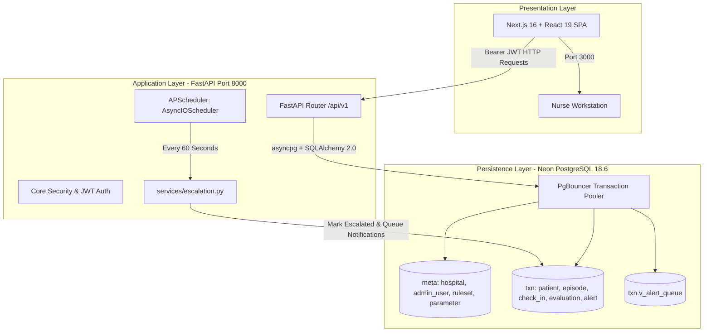

# ERAS Hospital-Side Backend & Architecture Guide (Page 1: Dashboard / Risk Queue)

> **Document**: 4 of 4 · Technical Implementation Reference  
> **System**: Post-Operative Remote Patient Monitoring after Knee Arthroplasty  
> **Scope**: Page 1 (Dashboard / Risk Queue) Backend, Database, Authentication & Escalation  
> **Author**: Engineering Team  
> **Last Updated**: September 2026  

---

## 1. Executive Summary & Scope

This document provides a comprehensive reference for the ERAS hospital-side backend, specifically built for **Page 1 (Dashboard / Risk Queue)**.

The system monitors post-discharge knee replacement patients recovering at home. Patients submit daily vitals and symptom checks, which are processed against post-operative day-banded clinical thresholds. The clinic dashboard provides nurses and on-call surgeons with a prioritized queue that sorts itself by clinical risk (`emergency` > `critical` > `review` > `missed`), ensuring urgent complications (such as DVT, pulmonary embolism risk, or surgical site infection) are surfaced immediately.

### Scope Boundaries for this Component
* **IN SCOPE**:
  * Multi-tenant hospital administration and role authentication (`meta.admin_user`).
  * Risk queue read endpoint (`GET /api/v1/dashboard/queue`) backed by `txn.v_alert_queue`.
  * Dashboard Key Performance Indicators (`GET /api/v1/dashboard/kpis`).
  * Alert acknowledgement state machine (`POST /api/v1/alerts/{alert_id}/acknowledge`).
  * In-process 60-second automated escalation sweep (`APScheduler`).
  * Neon PostgreSQL database schema (`meta` and `txn` namespaces).
  * Next.js desktop clinical frontend integration.
* **EXPLICITLY OUT OF SCOPE (Handled in later stages)**:
  * Patient-facing WhatsApp webhook ingestion and chat automation.
  * Direct patient mobile check-in submission endpoints.
  * Pages 2 through 9 (Enrollment, Rulesets, Hospitals, WhatsApp Templates, Reports, Settings, Full Patient Detail / Wound analysis).

---

## 2. Technology Stack & Runtime Architecture



| Component | Technology | Version | Key Design Rationale |
| :--- | :--- | :--- | :--- |
| **Web Framework** | FastAPI | `0.141.1` | Native async support, OpenAPI typing, sub-millisecond route latency. |
| **ASGI Server** | Uvicorn (standard) | `0.53.0` | High-concurrency production server with uvloop/httptools. |
| **ORM** | SQLAlchemy (Async 2.0) | `2.0.54` | Typed declarative models, async session management. |
| **Database Driver** | asyncpg | `0.31.0` | High-throughput asynchronous PostgreSQL driver. |
| **Migration Client**| psycopg (binary) | `3.3.5` | Used by migration runner for transactional DDL scripts. |
| **Database Engine** | PostgreSQL on Neon | `18.6` | Serverless Postgres hosted in AWS `ap-southeast-1` via PgBouncer. |
| **Validation** | Pydantic & Settings | `2.13.5` | Strict schema validation; separates API contract from DB models. |
| **Security & Auth** | PyJWT & bcrypt | `2.14.0` / `4.0.1` | SHA-256 HMAC JWTs; bcrypt with rounds=12 (locked for Python 3.12). |
| **Task Scheduler** | APScheduler | `3.11.3` | AsyncIOScheduler running in-process for the 60s escalation sweep. |
| **Frontend** | Next.js (App Router) | `16.3.5` | React desktop-first dashboard styled with Tailwind CSS tokens. |

---

## 3. Database Architecture & Schema Specification

The database utilizes two PostgreSQL schemas for clear separation of concerns:
* **`meta`**: Reference entities, parameter definitions, and versioned rulesets (slow-changing).
* **`txn`**: Clinical transactions, patient episodes, submissions, evaluations, and alerts (fast-growing).

### 3.1 Schema Map

#### `meta` Schema Tables
1. **`meta.hospital`**: Multi-tenant hospital records. Enforces `ack_window_secs` (escalation timer, default 900s / 15 mins).
2. **`meta.admin_user`** *(Added in Migration 001)*: Hospital-scoped clinician/admin accounts. Enforces `UNIQUE (hospital_id, email)` and role constraints (`admin`, `superadmin`).
3. **`meta.surgical_procedure`**: Procedure catalog (e.g. `'TKR'`, observation duration 84 days). Renamed to avoid PostgreSQL reserved keyword.
4. **`meta.hospital_procedure`**: Junction mapping which hospital offers which surgical procedure.
5. **`meta.parameter`**: Strongly-typed metric registry (`numeric`, `boolean`, `ordinal`) with value range constraints and alert polarity.
6. **`meta.parameter_option`**: Ordinal ranks for milestone evaluation (e.g. walking aids: walker < crutches < cane < none).
7. **`meta.ruleset`**: Versioned scoring envelope. A partial unique index guarantees that **at most one ruleset per procedure can have status `'approved'`**.
8. **`meta.procedure_parameter`**: Binds parameters to rulesets. Decouples **collection window** (`collect_from_day` to `collect_to_day`) from **scoring window** (`score_from_day` to `score_to_day`), and stores rule scoring algorithms in JSONB.

#### `txn` Schema Tables
1. **`txn.patient`**: Persistent demographic identity (MRN, phone_e164 with regex validation, language: en/ta/hi).
2. **`txn.patient_episode`**: Specific surgical recovery journey. Enforces that a patient can have **at most one active episode at a time**. `enrolled_by` links to `meta.admin_user`.
3. **`txn.episode_baseline`**: Discharge vitals anchor. Enforces that exactly one value type (`num`, `bool`, `code`) is populated per metric.
4. **`txn.patient_check_in`**: Daily submission header. Includes `captured_at` and `idempotency_key` to guarantee safe offline queue replays without duplicates.
5. **`txn.patient_check_in_value`**: Normalized submission answers. Missing rows indicate unanswered parameters (treated as unknown, not masked as normal).
6. **`txn.check_in_evaluation`**: Immutable decision log of the clinical rules engine (`tier`, `total_score`, `reasons` JSONB array, `reason_key` hash). `check_in_id` is nullable to allow evaluating missed check-ins via synthetic empty readings.
7. **`txn.alert`**: Clinical alert entity. State machine: `open` $\rightarrow$ `acknowledged` $\rightarrow$ `resolved` or `expired`. Requires a recorded clinical outcome upon resolution. `acknowledged_by` and `resolved_by` link to `meta.admin_user`.
8. **`txn.alert_notification`**: Multi-channel delivery audit (`push`, `sms`, `email`).

### 3.2 The Nurse Triage View (`txn.v_alert_queue`)

The dashboard queue is powered directly by an optimized SQL view:

```sql
CREATE OR REPLACE VIEW txn.v_alert_queue AS
SELECT 
    a.alert_id,
    a.tier,
    a.status,
    a.raised_at,
    (EXTRACT(epoch FROM (now() - a.raised_at)))::integer AS age_secs,
    (a.acknowledged_at IS NOT NULL) AS acknowledged,
    a.acknowledged_at,
    a.acknowledged_by,
    au.full_name AS acknowledged_by_name,
    pt.patient_id,
    pt.patient_name,
    pt.mrn,
    e.episode_id,
    e.hospital_id,
    h.hospital_name,
    sp.procedure_code,
    ev.day_after_discharge,
    ev.reasons
FROM txn.alert a
JOIN txn.check_in_evaluation ev ON ev.evaluation_id = a.evaluation_id
JOIN txn.patient_episode e      ON e.episode_id = a.episode_id
JOIN txn.patient pt             ON pt.patient_id = e.patient_id
JOIN meta.hospital h            ON h.hospital_id = e.hospital_id
JOIN meta.surgical_procedure sp ON sp.procedure_id = e.procedure_id
LEFT JOIN meta.admin_user au     ON au.admin_user_id = a.acknowledged_by
WHERE a.status IN ('open', 'acknowledged')
ORDER BY
    CASE a.tier 
        WHEN 'emergency' THEN 1 
        WHEN 'critical'  THEN 2 
        WHEN 'review'    THEN 3 
        WHEN 'missed'    THEN 4 
        ELSE 5 
    END,
    a.raised_at ASC;
```

---

## 4. Critical Production Nuances & Gotchas Resolved

### 4.1 Neon PgBouncer Transaction Pooling vs. asyncpg Prepared Statements
* **The Problem**: Neon uses PgBouncer in transaction-pooling mode. By default, `asyncpg` caches prepared statements per connection. In transaction pooling, sequential queries from the same application connection may execute on different backend PostgreSQL connections, causing intermittent `prepared statement "..." already exists` crashes.
* **The Solution**: In `app/db/session.py`, statement caching is disabled at the driver level:
  ```python
  async_engine = create_async_engine(
      settings.async_database_url,
      connect_args={
          "statement_cache_size": 0,
          "prepared_statement_cache_size": 0,
          "ssl": "require",
      }
  )
  ```

### 4.2 Dynamic DSN Adaptation
* **The Problem**: Neon connection strings use `postgresql://...` with parameters like `sslmode=require` and `channel_binding=require`. Passing this directly to SQLAlchemy with asyncpg causes DSN keyword argument parsing errors.
* **The Solution**: `app/core/config.py` provides a property `settings.async_database_url` that automatically replaces the driver with `postgresql+asyncpg`, removes incompatible query strings, and handles SSL cleanly.

### 4.3 Python 3.12 Compatibility with Password Hashing
* Standard `passlib` has a known bug with `bcrypt >= 4.1.0` on Python 3.12 (`__about__` attribute error or 72-byte truncation issues).
* **The Solution**: `bcrypt==4.0.1` is explicitly locked, and password hashing in `app/core/security.py` uses direct, thread-safe `bcrypt.hashpw` and `bcrypt.checkpw`.

### 4.4 Multi-Tenant Security & 404-on-Cross-Hospital Defense
* Every query is filtered by the `hospital_id` extracted from the cryptographically verified JWT.
* When acknowledging an alert (`POST /api/v1/alerts/{alert_id}/acknowledge`), if the alert belongs to another hospital, the API returns **`404 Not Found`** instead of `403 Forbidden`. This prevents attackers from probing the system to confirm the existence of patient IDs in other hospitals.

---

## 5. Implementation Roadmap & Current Status

| Step | Component | Status | Artifacts / Verification |
| :---: | :--- | :---: | :--- |
| **Step 1** | **Database Migration & DDL Evolution** | **DONE** | `db/migrations/001_admin_user_and_fk_cleanup.sql`<br>`db/run_migration.py` (Applied to Neon) |
| **Step 2** | **Scaffolding, Dependencies & Environment** | **DONE** | `backend/requirements.txt`<br>`backend/.env.example`<br>`backend/verify_step2.py` |
| **Step 3** | **Core Configuration, Security & Async DB Session** | **DONE** | `app/core/config.py`<br>`app/db/session.py`<br>`app/core/security.py`<br>`backend/verify_step3.py` |
| **Step 4** | **SQLAlchemy 2.0 Async ORM Models** | **DONE** | `app/db/models/meta.py`<br>`app/db/models/txn.py`<br>`backend/verify_step4.py` (16 models verified against live DB) |
| **Step 5** | **Pydantic v2 Request & Response Schemas** | **DONE** | `app/schemas/auth.py`<br>`app/schemas/dashboard.py`<br>`app/schemas/alert.py`<br>`backend/verify_step5.py` |
| **Step 6** | **API Endpoints (v1) & FastAPI Main App** | **DONE** | `app/api/v1/auth.py`<br>`app/api/v1/dashboard.py`<br>`app/api/v1/alerts.py`<br>`app/main.py`<br>`backend/verify_step6.py` |
| **Step 7** | **In-Process Escalation Sweep & Scheduler** | **DONE** | `app/services/escalation.py`<br>`app/main.py` lifespan<br>`backend/verify_step7.py` |
| **Step 8** | **Comprehensive Demo Seed Script** | **DONE** | `seed/seed_demo.py`<br>`backend/verify_step8.py` (Seeded 3 admins + 7 alerts over 13 patients) |
| **Step 9** | **Automated Test Suite** | **DONE** | `tests/conftest.py`<br>`tests/test_auth.py`<br>`tests/test_dashboard.py`<br>`tests/test_alerts.py`<br>`tests/test_escalation.py` (16/16 tests passing) |
| **Step 10** | **Next.js Frontend Integration** | **DONE** | `frontend/src/lib/api.ts`<br>`frontend/src/app/page.tsx`<br>`backend/verify_step10.py` (Live Neon PostgreSQL & CORS) |

---

## 6. How to Run, Test and Verify the Backend

### 6.1 Environment Setup
1. Ensure Python 3.10+ is installed.
2. Ensure `backend/.env` exists and contains:
   ```env
   DATABASE_URL=postgresql://neondb_owner:<password>@<neon-pooler-host>/simpleeras?sslmode=require&channel_binding=require
   JWT_SECRET_KEY=<random-32-byte-hex>
   JWT_ALGORITHM=HS256
   ACCESS_TOKEN_EXPIRE_MINUTES=720
   CORS_ORIGINS=http://localhost:3000,http://127.0.0.1:3000
   DEFAULT_ACK_WINDOW_SECS=900
   ESCALATION_SWEEP_INTERVAL_SECS=60
   ```

### 6.2 Running Migrations
To apply the database schema changes:
```bash
python db/run_migration.py
```

### 6.3 Executing Completed Verification Suites
You can run any of the step verification scripts at any time:
```bash
# Step 2: Test imports, bcrypt, JWT roundtripping
python backend/verify_step2.py

# Step 3: Test Neon asyncpg connection and statement caching flags
python backend/verify_step3.py

# Step 4: Test all 16 SQLAlchemy 2.0 ORM models against live database
python backend/verify_step4.py

# Step 5: Test Pydantic v2 schemas and validation rules
python backend/verify_step5.py

# Step 6: Test API endpoints with mocked auth/db
python backend/verify_step6.py

# Step 7: Test escalation background sweep logic
python backend/verify_step7.py

# Step 8: Seed demo data and verify full end-to-end integration
python backend/seed/seed_demo.py
python backend/verify_step8.py

# Step 9: Run complete automated test suite (16 tests)
pytest -v

# Step 10: Verify Next.js frontend integration & CORS headers
python backend/verify_step10.py
```

### 6.4 Starting the Servers
* **Backend API** (FastAPI):
  ```bash
  cd backend
  uvicorn app.main:app --reload --port 8000
  ```
  API Documentation will be available at: `http://localhost:8000/docs`
* **Frontend Application** (Next.js):
  ```bash
  cd frontend
  npm run dev -- --port 3000
  ```
  Dashboard UI will be available at: `http://localhost:3000`
